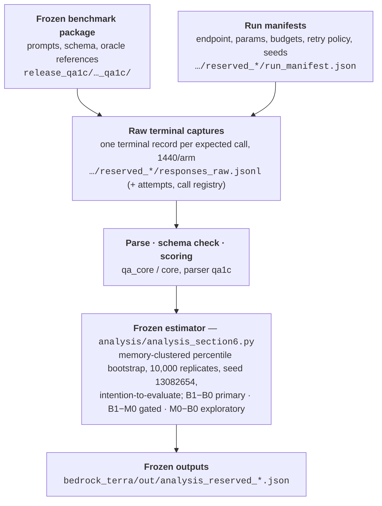

# Reproducibility

Everything analytical in Experiment 1 can be re-derived offline from
this repository: raw terminal captures → parsing → scoring → frozen
statistics. No model calls and no network are needed, and none are
permitted by the frozen protocol (a rescore must use preserved
captures).

## Quick start

Requirements: Python ≥ 3.8 and `numpy` (the only dependency of the
frozen estimator).

```bash
# Verify the three headline results end-to-end (offline, ~1 min):
python3 reproduce/verify_experiment1.py

# Re-derive one Bedrock arm through the frozen pipeline yourself:
python3 reproduce/run_frozen_analysis.py out/reserved_qwen3 qwen3 my_qwen3.json
python3 reproduce/run_frozen_analysis.py out/reserved_terra terra my_terra.json
```

`verify_experiment1.py` re-runs the full frozen pipeline for the Terra
and Qwen3 reserved arms from `responses_raw.jsonl` and checks that
accuracies, primary contrast **and the 95% bootstrap interval** match
the frozen outputs byte-for-value (the bootstrap is deterministic:
seed 13082654, 10,000 replicates, memory-clustered percentile). For the
Kimi arm it recomputes the point estimates from the qa1c-scored records
of the sealed confirmatory run and checks them against the signed
result (+9.79 pp, CI95 [+5.00, +14.79]).

## The frozen pipeline



Everything below the captures re-runs offline; the reproduction
scripts drive exactly this path.

The frozen entry point `bedrock_terra/analysis_dev_arm.py` references
the signed estimator through an absolute path from the original
execution machine; `reproduce/run_frozen_analysis.py` redirects it to
the in-repo copy `analysis/analysis_section6.py`, which is
byte-identical (SHA-256
`997538895c4b2d093a1df3619dcfa70734d3e9858ce3fac8524fcb96984858ea`)
and changes nothing else.

## Scoring rule (a trap to avoid)

A call scores correct only when its parsed output is
`COMPLETED_VALID`, passes the frozen schema check, **and** the reaction
is consistent with the cited rule (`reaction_correct AND
reaction_rule_consistent`). Invalid outputs and budget exhaustion score
as incorrect under the intention-to-evaluate denominator; no repair
call is permitted.

Do not score the Qwen3 arm from
`bedrock_terra/out/reserved_qwen3/scoring_records.jsonl`: that file is
an earlier, partial scorer artifact (it lacks the consistency field)
and over-counts one call. The authoritative route is re-derivation from
`responses_raw.jsonl` through the frozen pipeline, as the reproduction
scripts do. The Terra records carry the full field set, and the Kimi
arm's `audit_extension/results/kimi_confirmatory/kimi_reserved_scored_qa1c.jsonl`
is the final qa1c-scored output of the sealed run.

## Determinism and seeds

- Analysis: fully deterministic (bootstrap seed 13082654 inside the
  frozen estimator). Re-running reproduces identical intervals.
- Kimi-arm generation: temperature 0, top_p 1, request seed 13082642,
  call-order seed 13082652 (run manifest). Statelessness was verified
  during execution.
- Bedrock arms: the service does not honour request-level determinism;
  this is disclosed in the pre-execution amendment record
  (`bedrock_terra/EDCA_preexecution_amendment_record_2026-08-19.html`).
  Reproducibility for these arms means re-derivation of results from
  the preserved captures, not regeneration of model outputs.

## Seals and authorisation records

The analysis tooling enforces the inspection protocol by construction:

- reserved runs refuse to load unless a signed inspection authorisation
  naming that exact run exists in `bedrock_terra/signature/` (it prints
  who released the seal and on whose instruction);
- the Qwen3 development arm refuses without the digest of the signed
  pre-execution amendment record (`bedrock_terra/RECORD_SHA256.txt`);
- `bedrock_terra/blind_operational_summary.py` refuses by code to read
  scoring records — it is the tool for looking at a run without
  contaminating yourself.

The authorisation records needed to re-derive every result reported
here are included, so the reproduction scripts run as-is.

## Integrity references

- Freeze records and dependency pins:
  `release_qa1c/…/validation/freeze_record_v0_5_1_qa1c.json` (the audit
  gate was found sensitive to scikit-learn versions, hence the pins;
  the section-6 estimator itself needs only numpy).
- Record digests: `bedrock_terra/RECORD_SHA256.txt`.
- Pre-registration hashes (family analysis, repeat run, Kimi replay):
  `bedrock_terra/exp/PREREG_*_SHA256.txt`,
  `audit_extension/validation/PREREG_replay_recall_kimi_2026-08-22.json`.
- Kimi replay test, executed 8 November 2026:
  `audit_extension/results/kimi_confirmatory/CONFIRMATORY_RESULT.json`
  records the SHA-256 of the signed prereg, the authorisation, the input
  and the interval code it ran under, and all four match the published
  files.
- Redaction after freeze: 28 files had private infrastructure
  identifiers redacted for publication (`SANITIZATION.md`); the bytes
  of those specific files no longer match the recorded hashes. All
  scientific content is intact.

## What cannot be reproduced from here

- New model calls: the Kimi-arm endpoint is private (redacted) and the
  Bedrock arms require an AWS account; neither is needed for any
  reported number.
- The Kimi replay test as a *confirmatory* run: it was a one-shot test,
  executed on 8 November 2026, and the runner refuses a second run. Its
  numbers do re-derive offline:
  `python3 audit_extension/scripts/run_confirmatory_replay.py --dry-run-on audit_extension/results/kimi_confirmatory/kimi_reserved_scored_qa1c.jsonl`
  reproduces every endpoint field of `CONFIRMATORY_RESULT.json`.
